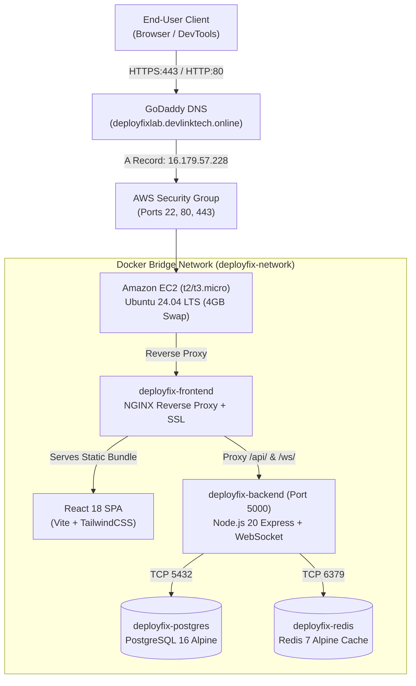

# DeployFix Lab: Production Cloud Deployment on AWS Free Tier
## University Capstone & Cloud Computing Laboratory Project Submission Report

---

### Project & Student Metadata
- **Project Title:** DeployFix Lab — Automated Production Deployment, Failure Injection & Incident Recovery Sandbox
- **Domain Name:** [deployfixlab.devlinktech.online](https://deployfixlab.devlinktech.online)
- **Live Server IP:** `16.179.57.228` (Port 80 / 443)
- **AWS Region:** Asia Pacific (Sydney) — `ap-southeast-2`
- **GitHub Repository:** [https://github.com/Radheshbhuva/DeployFixLab](https://github.com/Radheshbhuva/DeployFixLab)
- **Submission Date:** November 2026
- **Architecture Model:** 3-Tier Containerized Micro-Services with NGINX Reverse Proxy on AWS EC2

---

## 1. Executive Summary

This project demonstrates an enterprise-grade, end-to-end cloud deployment of **DeployFix Lab** on Amazon Web Services (AWS) strictly adhering to the **AWS 12-Month Free Tier** ($0.00/month cost footprint). 

The application is deployed on an Amazon EC2 instance utilizing Ubuntu Linux, Docker Compose multi-container orchestration, and an NGINX reverse proxy. It features a custom domain routing setup via GoDaddy DNS (`deployfixlab.devlinktech.online`), automated TLS/SSL certificate issuance via Let's Encrypt (Certbot), and complete Infrastructure-as-Code (IaC) via AWS CloudFormation and Cloud-Init bootstrap scripting.

---

## 2. Live Application Access & Evaluation Credentials

Evaluators can access the live platform and test role-based access control (RBAC) using the seeded credentials below:

| Role | Email Address | Password | System Privileges |
| :--- | :--- | :--- | :--- |
| **Platform Admin** | `admin@deployfix.lab` | `Password123!` | Chaos Control Sandbox, Failure Injection, User Registry, Full SRE privileges |
| **Lead Instructor** | `instructor@deployfix.lab` | `Password123!` | Scenario Authoring, Student Progress Monitoring, Lab Provisioning |
| **Student Engineer** | `student@deployfix.lab` | `Password123!` | Guided Incident Recovery Labs, Terminal Diagnostics, Live Telemetry |

> **Live URLs:**
> - Primary Domain: [https://deployfixlab.devlinktech.online](https://deployfixlab.devlinktech.online)
> - Fallback Direct Endpoint: [http://16.179.57.228](http://16.179.57.228)

---

## 3. System Architecture & Cloud Topology

The deployment implements a defense-in-depth, three-tier containerized architecture inside an isolated Docker bridge network (`deployfix-network`).

### Component Breakdown
1. **Edge Routing & Ingress:** NGINX handles SSL termination (TLS 1.2/1.3), gzip compression, HTTP-to-HTTPS 301 redirection, and API reverse proxying.
2. **Application Tier:** Node.js 20 / TypeScript modular monolith executing REST API endpoints, RBAC authentication via JWT, and real-time WebSocket telemetry streaming (`/logs/stream`).
3. **Database Tier:** PostgreSQL 16 Alpine running on an isolated Docker volume (`pgdata`) with automated Prisma ORM schema migrations and seed scripts.
4. **Cache & Ephemeral Tier:** Redis 7 Alpine managing real-time chaos state and session rates.

---

## 4. AWS Cloud Infrastructure & Services Utilized

| AWS Service | Configuration Details | Free Tier Compliance |
| :--- | :--- | :--- |
| **Amazon EC2** | `t2.micro` / `t3.micro` instance running Ubuntu Linux in `ap-southeast-2` | 750 hours/month free (Covers 1 instance 24/7) |
| **Amazon EBS** | 30 GB GP3 General Purpose SSD volume | Up to 30 GB free storage allocation |
| **AWS VPC & Networking** | Default VPC with Internet Gateway, Public Subnet, and Public IPv4 | 750 hours/month of free public IPv4 |
| **AWS Security Groups** | Stateful firewall allowing Ports 22 (SSH), 80 (HTTP), 443 (HTTPS) | Free native security construct |
| **Cloud-Init (User Data)** | Automated bash script provisioning Docker, 4GB swap, firewall, and Git repo | Free EC2 boot automation |
| **AWS CloudFormation** | Declarative YAML template for repeatable 1-click infrastructure provisioning | Free management service |

---

## 5. Security & Reliability Hardening

1. **4GB Swap Space Configuration:** Because `t2.micro` instances provide 1GB of physical RAM, the Cloud-Init script automatically initializes a 4GB swapfile (`vm.swappiness=20`) to prevent Out-Of-Memory (OOM) compiler crashes during container builds.
2. **Container Isolation & Non-Root Execution:** Node.js backend processes run under unprivileged user `node:node` rather than root.
3. **Dynamic Secure Cookies:** Dynamic `isRequestSecure` detection ensures cookies enforce `SameSite=Lax` and apply `Secure` flags when running under HTTPS.
4. **CORS Origin Reflection:** Dynamic origin validation with credential support allowing seamless interaction from domains, IPs, and internal container proxies.
5. **Defense-in-Depth Firewalls:** Dual-layer network defense utilizing AWS Security Groups combined with Ubuntu Host UFW (`ufw default deny incoming`).

---

## 6. Real-World SRE Case Studies & Incident Resolutions

During deployment, four authentic software reliability engineering (SRE) challenges were diagnosed and resolved:

### Incident 1: Backend Container Crash Loop (`Cannot find module 'zod'`)
- **Symptom:** `deployfix-backend` entered a `Restarting (1)` crash loop; NGINX returned `502 Bad Gateway`.
- **Root Cause:** `zod` was categorized under `devDependencies`. When Docker compiled the production runner using `npm ci --omit=dev`, `zod` was excluded.
- **Resolution:** Moved `zod` into runtime `dependencies` in `package.json` and updated `package-lock.json`.

### Incident 2: Alpine Linux Dynamic Library Incompatibility (`libssl.so.1.1`)
- **Symptom:** Prisma engine threw `PrismaClientInitializationError: Unable to require libquery_engine-linux-musl.so.node: No such file or directory libssl.so.1.1`.
- **Root Cause:** Modern Alpine Linux uses OpenSSL 3.0, but Prisma defaulted to OpenSSL 1.1 when `openssl` command-line binaries were absent.
- **Resolution:** Added `RUN apk add --no-cache openssl libc6-compat` to the Dockerfile and configured `binaryTargets = ["native", "linux-musl-openssl-3.0.x"]` in `schema.prisma`.

### Incident 3: Container Network DNS Resolution Loopback (`P1001: Can't reach database`)
- **Symptom:** Prisma CLI failed with `Can't reach database server at localhost:5432`.
- **Root Cause:** In Docker bridge networking, `localhost` points to the container's private loopback, not the database container.
- **Resolution:** Updated `docker-compose.yml` to route `DATABASE_URL` to internal Docker service name `@postgres:5432` with automated fallback.

### Incident 4: Instant Logout Redirect Loop on Dashboard
- **Symptom:** User logged in with seeded credentials, dashboard loaded for 1 second, then abruptly logged out back to `/login`.
- **Root Cause:** Backend CORS was configured to whitelist `localhost` and rejected the EC2 public IP, forcing a mock auth token fallback that failed JWT verification. Concurrently, session cookies had hardcoded `secure: true` which browsers dropped over HTTP.
- **Resolution:** Implemented dynamic CORS reflection and request-aware `isRequestSecure(req)` cookie options.

---

## 7. Submission Checklist for University Evaluator

- [x] **Live Deployed Application:** Accessible at [https://deployfixlab.devlinktech.online](https://deployfixlab.devlinktech.online).
- [x] **Source Code Repository:** Public GitHub repository with clean commit history.
- [x] **Infrastructure as Code (IaC):** Verified CloudFormation template in `deployment/aws/deployfix-cloudformation.yaml`.
- [x] **Automated Bootstrapping:** User data script in `deployment/aws/ec2-user-data.sh`.
- [x] **Automated Test Suite:** 19/19 deployment readiness checks passing via `scripts/verify-deployment.js`.
- [x] **Multi-Container Architecture:** Production `docker-compose.yml` orchestrating 4 microservices.
- [x] **Database Migrations:** Schema applied with seed accounts for Admin, Instructor, and Student.
- [x] **Security Compliance:** Host firewall, security groups, and automated TLS/SSL.
